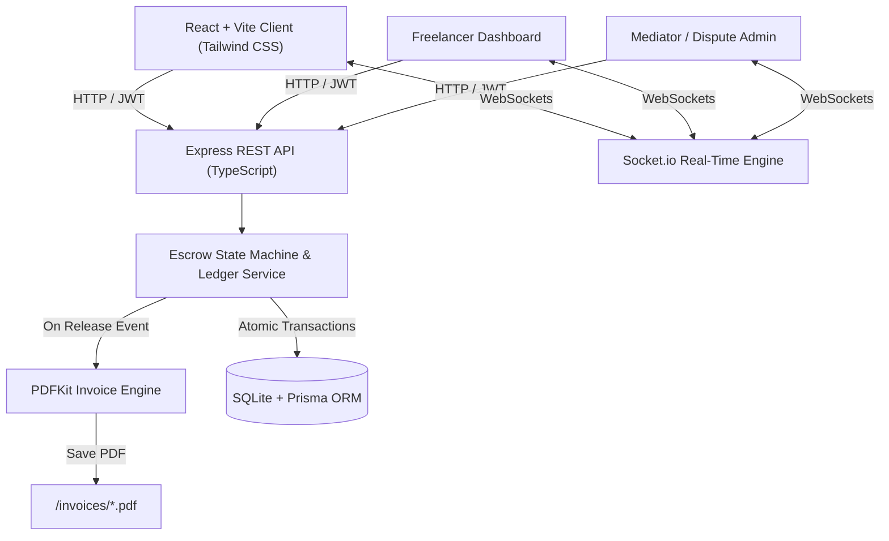
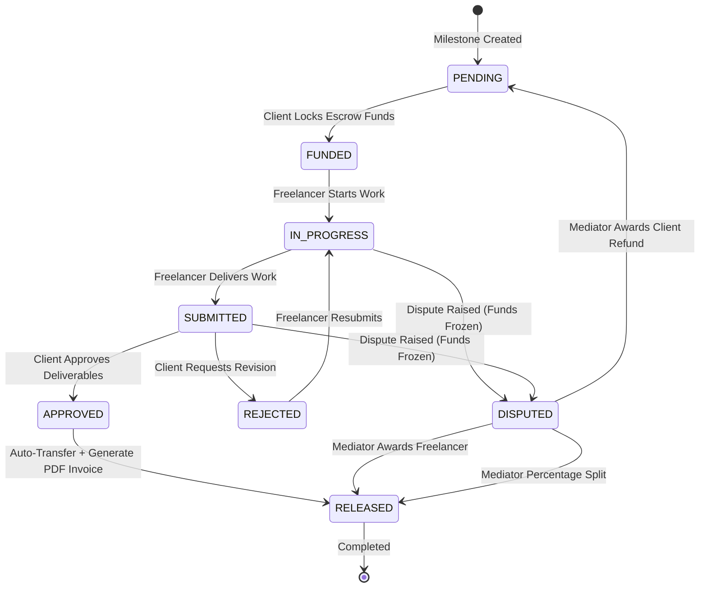

# TrustPay — Trust-Bound Freelance Escrow & Invoicing Platform

[](https://www.typescriptlang.org/)
[](https://reactjs.org/)
[](https://nodejs.org/)
[](https://www.prisma.io/)
[](https://tailwindcss.com/)
[-emerald.svg)](https://vitest.dev/)

**TrustPay** is a milestone-based digital escrow and automated invoicing web application designed to protect independent gig workers and student freelancers from delayed payments, scope creep, and payment defaults.

---

## 📌 Problem & Solution

### The Problem
Student freelancers and independent developers frequently encounter:
* Clients defaulting on payments or disappearing after work is submitted.
* Scope creep with no legal agreement or audit trail.
* Financial uncertainty and time lost chasing unpaid invoices.

### The Solution
TrustPay establishes a smart financial bridge:
1. **Pre-Funded Milestone Escrow:** The client deposits funds into escrow *before* work starts on each milestone.
2. **Strict State Machine Workflow:** Milestone funds cannot be prematurely released or arbitrarily withheld.
3. **Cryptographically Signed Contracts:** Scopes are frozen using SHA-256 document hashing with digital signatures and IP logging.
4. **Automated Invoicing & Audit Trail:** Upon milestone approval, funds release instantly to the freelancer's wallet and an official, numbered PDF invoice is generated automatically.
5. **Integrated Dispute Resolution:** In the event of a disagreement, funds freeze immediately and a mediator can resolve via full release, refund, or percentage split.

---

## 🏗️ System Architecture



---

## 🔄 Milestone Escrow State Machine

Every milestone progresses through a strict, tamper-proof state machine:



---

## 🔐 Key Engineering & Security Highlights

1. **Integer Money Representation (Paise):**
   * Floating-point numbers (`0.1 + 0.2 = 0.30000000000000004`) lead to critical rounding discrepancies in financial systems.
   * All monetary amounts are stored as integer **paise** (₹1 = 100 paise) and formatted strictly on the presentation layer.

2. **Atomic Database Transactions:**
   * Every financial action (locking escrow, releasing funds, dispute splits) runs inside `db.$transaction()`.
   * If any step fails, the entire operation rolls back—eliminating partial balance transfers or orphaned state changes.

3. **Immutable Financial Ledger:**
   * Double-entry style append-only ledger (`DEPOSIT`, `LOCK`, `RELEASE`, `REFUND`, `SPLIT`).
   * Ledger rows are **never edited or deleted**, guaranteeing a 100% verifiable financial audit trail.

4. **Cryptographic SHA-256 Contract Integrity:**
   * When milestones are confirmed, a formal Markdown contract is rendered and hashed using Node's `crypto` module.
   * Both parties sign with legal name, timestamp, and IP address. Any attempt to modify scope invalidates the contract hash.

5. **Automated Auto-Approval Daemon:**
   * Protects freelancers from client ghosting. If a client fails to review submitted work within 7 days, the system auto-approves and releases payment.

---

## 🚀 Quickstart & Setup

### Prerequisites
* Node.js (v18 or higher)
* npm (v9 or higher)

### 1. Clone & Setup
```bash
# Navigate to project root
cd trustpay

# Install dependencies (root, server, client)
npm run setup
```

### 2. Environment Configuration
The server comes pre-configured with a default `.env` file:
```env
DATABASE_URL="file:./dev.db"
JWT_SECRET="trustpay_dev_secret_change_in_production_abc123xyz789"
JWT_EXPIRES_IN="7d"
PORT=5000
CLIENT_URL="http://localhost:5173"
AUTO_APPROVE_DAYS=7
MAX_TOPUP_PAISE=100000000
```

### 3. Initialize Database & Seed Demo Data
```bash
npm run seed
```
This initializes the SQLite database and populates ready-to-test demo data.

### 4. Run the Full Application
```bash
npm run dev
```
* **Frontend:** [http://localhost:5173](http://localhost:5173)
* **Backend API:** [http://localhost:5000/api](http://localhost:5000/api)

---

## 👥 Demo Accounts (Pre-Seeded)

| Role | Email | Password | Pre-loaded Wallet Balance |
| :--- | :--- | :--- | :--- |
| **CLIENT** | `client@demo.com` | `Demo1234!` | ₹1,00,000 (Demo Funds) |
| **FREELANCER** | `freelancer@demo.com` | `Demo1234!` | ₹0.00 |
| **MEDIATOR** | `admin@demo.com` | `Demo1234!` | Administrative Access |

> **Sample Project:** "Portfolio Website Redesign" (₹50,000 value, contract signed, Milestone 1 pre-funded and ready for review).

---

## 🧪 Testing

Run backend unit tests verifying state machine transitions, money calculations, and SHA-256 integrity:
```bash
npm run test
```
**Results:** 12 passed unit tests via Vitest.

---

## 📄 License
MIT License. Built as an open-source educational and portfolio showcase project.
